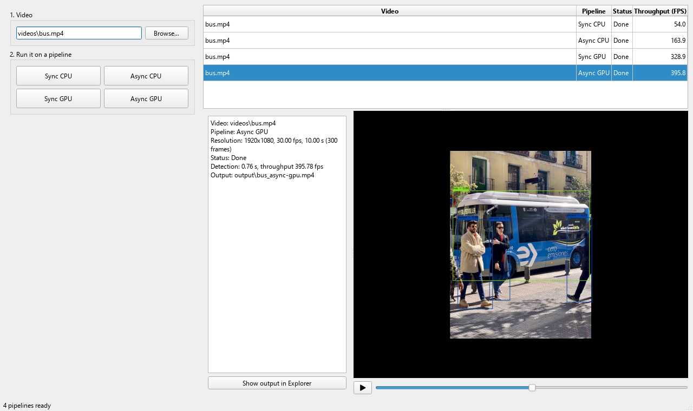

# YOLO TensorRT for Windows

[](https://github.com/trandinhnguyen/yolo-tensorrt-windows/actions/workflows/ci.yml)
[](LICENSE)


A Windows desktop app for object detection and tracking in videos, using
**YOLOv8** and **NVIDIA TensorRT**. The same model runs through four pipelines
(sync and async, on the CPU or fully on the GPU) so you can see how much each
optimization buys you, and it packages into a standalone `.exe` with
PyInstaller.



## Features

- **Four interchangeable pipelines** to compare: CPU or GPU pre/post-processing,
  each either sequential or with one thread per stage.
- **TensorRT inference** with FP16 where the GPU supports it. TensorRT 10.0 is
  used on GPUs with compute capability 7.0 and newer, TensorRT 8.5 on Pascal and
  older; the engine is built from the ONNX model on first start and cached.
- **End-to-end GPU pipelines**: NVDEC decoding, preprocessing, inference and NMS
  without copying frames back to the CPU.
- **ByteTrack** multi-object tracking implemented in PyTorch.
- **Desktop UI** (Qt): queue videos, watch progress and throughput live, and play
  the annotated result.
- **One-command setup** that fetches TensorRT, the CUDA libraries, FFmpeg and the
  model.

## How it works

Each pipeline runs in its own worker process and turns every frame into
detections through the same stages:

```
decode ─► preprocess ─► TensorRT (YOLOv8n) ─► postprocess (NMS) ─► [track] ─► draw & save
```

| Pipeline  | Decode             | Pre/post-processing | Stages run       |
| --------- | ------------------ | ------------------- | ---------------- |
| Sync CPU  | OpenCV             | NumPy on the CPU    | one after another, with tracking |
| Async CPU | OpenCV             | NumPy on the CPU    | in parallel threads |
| Sync GPU  | FFmpeg NVDEC       | PyTorch on the GPU  | one after another |
| Async GPU | FFmpeg NVDEC       | PyTorch on the GPU  | in parallel threads and CUDA streams |

Throughput is measured over decoding and detection, excluding writing the
annotated video.

### Example throughput

1080p H.264 video (300 frames), YOLOv8n FP16, RTX 4060 Ti, single run:

| Pipeline  | Throughput |
| --------- | ---------: |
| Sync CPU  | 54 fps (includes tracking) |
| Async CPU | 164 fps |
| Sync GPU  | 329 fps |
| Async GPU | 396 fps |

Your numbers will depend on the GPU, CPU and video; run the same video through
all four pipelines in the app to compare.

## Requirements

- Windows 10 or 11, 64-bit
- An NVIDIA GPU (Pascal or newer) with a recent driver
- [uv](https://docs.astral.sh/uv/getting-started/installation/), which also
  provides Python 3.10
- About 10 GB of disk space (CUDA PyTorch, TensorRT and the CUDA libraries)
- A free [NVIDIA Developer](https://developer.nvidia.com/) account, to download
  TensorRT 8.5

## Quick start

```ps1
git clone https://github.com/trandinhnguyen/yolo-tensorrt-windows.git
cd yolo-tensorrt-windows
.\scripts\setup.ps1
.venv\Scripts\Activate.ps1
python app.py
```

Then choose a video (or drop one on the window) and click a pipeline. The first
start builds the TensorRT engine, which takes a few minutes; later starts reuse
it. Annotated videos are written to `output\`.

### What the setup script does

The script is safe to re-run: each step is skipped once its result exists.

| Step | Result |
| --- | --- |
| Download and unzip [TensorRT 10.0.1](https://developer.nvidia.com/downloads/compute/machine-learning/tensorrt/10.0.1/zip/TensorRT-10.0.1.6.Windows10.win10.cuda-11.8.zip) and [TensorRT 8.5.3](https://developer.nvidia.com/downloads/compute/machine-learning/tensorrt/secure/8.5.3/zip/TensorRT-8.5.3.1.Windows10.x86_64.cuda-11.8.cudnn8.6.zip) | `lib\TensorRT-10.0.1.6`, `lib\TensorRT-8.5.3.1` |
| Vendor their Python bindings (the `.pyd` from each `cp310` wheel) | `yolo_tensorrt_windows\inference\tensorrt_1001`, `tensorrt_853` |
| Unpack the CUDA 11 cuBLAS/cuDNN/... DLLs from NVIDIA's pip wheels | `lib\nvidia` |
| Download a shared FFmpeg 6.1 build with NVDEC, for the GPU pipelines | `lib\ffmpeg\bin` |
| Export YOLOv8n with `scripts\export_onnx.ps1` in a throwaway environment, so `ultralytics` stays out of the app | `models\yolov8n.onnx` |
| Install PyTorch (CUDA 11.8) and everything in `pyproject.toml` via `scripts\install.ps1`, into the active virtual environment or a new `.venv` | Python environment |

**TensorRT 8.5.3 needs an NVIDIA Developer login.** If its zip isn't in `lib\`
or your Downloads folder, the script opens the download page in your browser;
save the zip into `lib\`. The script installs it at the end of the run if it has
arrived by then; otherwise run the script again. Pass `-SkipPythonDeps` to
manage the Python environment yourself.

## Configuration

Model size, confidence and NMS thresholds, queue sizes, the GPU decoder and the
tracker parameters are in
[`yolo_tensorrt_windows/config.py`](yolo_tensorrt_windows/config.py). To enable
tracking in another pipeline, set `tracking = True` on its class in
[`processors/cpu.py`](yolo_tensorrt_windows/processors/cpu.py) or
[`processors/gpu.py`](yolo_tensorrt_windows/processors/gpu.py).

## Build a standalone executable

```ps1
.\scripts\build.ps1
```

This creates `dist\ml_app\ml_app.exe` with the model, TensorRT, CUDA and FFmpeg
DLLs bundled. If you distribute a build, you also distribute those third-party
components; see [THIRD_PARTY_NOTICES.md](THIRD_PARTY_NOTICES.md).

## Project layout

```
app.py                     entry point (python app.py, PyInstaller)
app.spec                   PyInstaller build spec
yolo_tensorrt_windows/
  app.py                   startup: TensorRT engine, workers, window
  ui.py                    Qt desktop window and video player
  jobs.py                  worker processes and job bookkeeping
  task.py                  jobs and the messages exchanged with workers
  config.py                tunables
  paths.py                 file locations and DLL search paths
  video.py                 video probing, frame reading, annotated output
  detection/               letterbox, pre/post-processing, drawing
  inference/               TensorRT engine build/load and runners
  processors/              the four pipelines and the threaded stage runner
  tracking/                ByteTrack
scripts/                   setup, install, build and ONNX export scripts
tests/                     unit tests (no GPU needed)
experiments/               unfinished scratch scripts, not part of the app
```

## Development

The tests don't need a GPU, TensorRT or FFmpeg:

```ps1
uv venv --python 3.10
uv pip install -r pyproject.toml --extra dev
.venv\Scripts\python -m pytest
.venv\Scripts\ruff check .
```

See [CONTRIBUTING.md](CONTRIBUTING.md) for the full guide.

## Known limitations

- The GPU pipelines decode H.264 only (`h264_cuvid`); use a CPU pipeline for
  other codecs.
- Tracking is enabled only in the Sync CPU pipeline. The tracker works on GPU
  tensors too, but hasn't been tuned for the GPU pipelines.
- The annotated output has no audio track.
- One GPU (`cuda:0`) is used.

## License

[GNU AGPL v3.0](LICENSE). YOLOv8 by Ultralytics, which this app runs, is also
AGPL-3.0. Third-party code and the components downloaded by the setup script are
listed in [THIRD_PARTY_NOTICES.md](THIRD_PARTY_NOTICES.md).

## Acknowledgements

- [Ultralytics YOLOv8](https://github.com/ultralytics/ultralytics)
- [NVIDIA TensorRT](https://developer.nvidia.com/tensorrt)
- [ByteTrack](https://github.com/ifzhang/ByteTrack) and
  [Roboflow supervision](https://github.com/roboflow/supervision), which the
  tracker is ported from
- [FFmpeg](https://ffmpeg.org) builds by [gyan.dev](https://www.gyan.dev/ffmpeg/builds/)
